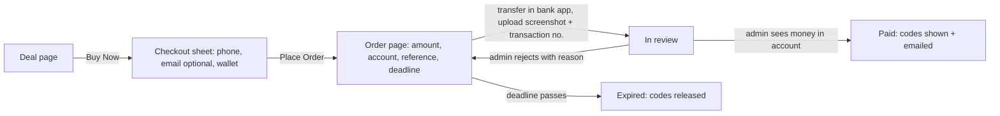

# Eshterakati — UX specification

Status: v2, Sudan market with receipt payments · Platform: responsive web (phone first) · Design language: Apple Human Interface Guidelines, adapted for the web (see [`design-system/MASTER.md`](../design-system/MASTER.md))

## 1. Product in one line

People in **Sudan** buy gift cards and subscription codes (streaming, gaming, shopping, software, often USD‑denominated cards like "$25") **in Sudanese pounds**, pay from the banking app they already use (Bankak, O‑Cash, Fawry), and get their codes within minutes of the store confirming the transfer. The store sells its own stock (first‑party).

**The core UX risks are trust and waiting.** A code is an invisible product, and payment is a manual bank transfer. Every screen has to answer one of: *Is this real? Did my payment arrive? How long until I get my code? What if it doesn't work?*

## 2. Who it's for

| Person | Job to be done | What they need from us |
| --- | --- | --- |
| **Subscriber** | "Keep my streaming/music subscription going without a foreign card." | Clear SDG prices per period, and an easy repeat purchase. |
| **Gamer topping up** | "Get store credit tonight." | The shortest path: deal → Buy Now → transfer → upload → code. Guest checkout, with live status while waiting. |
| **Gift buyer** | "Send someone a gift card." | Several values, buying more than one, and the codes by email so they can forward them. |

Usage context: phones on mobile data, sometimes unreliable connections and bank‑app outages. People are used to paying by sending a transfer screenshot.

## 3. Principles

1. **Clarity** (HIG) — one primary action per screen. Prices use tabular figures, and savings appear as both money and %.
2. **Deference** (HIG) — the content (merchant, value, price) leads. Chrome is translucent and recedes.
3. **Depth** (HIG) — tasks (Bag, Checkout) open in a sheet over the page, so people never lose their place.
4. **Trust, shown not claimed** — region, validity, verification and the refund promise sit right next to the price, not in a footer.
5. **Codes are secrets** — hidden by default in the wallet, can be copied without being revealed, and are emailed as a backup.
6. **Always show where the money is** — after checkout there is always a page that says which step the order is at, what the shopper must do next, and how long they have.
7. **Forgiving** — Undo instead of confirmation dialogs for reversible actions (remove from Bag, Mark as Used).

## 4. Information architecture

```
Discover (/)            Today's pick · categories · trending · ending soon · why buy here
Browse (/browse)        category grid · all deals
  └ Category (/browse/:category?sort=popular|savings|ending)
      └ Deal (/deals/:slug)            options · price · buy · how to redeem · terms · related
Search (/search?q=)     recent · suggested · results
My Codes (/codes?show=active|used)     orders in progress · wallet of purchased codes
Order (/orders/:id)     transfer details → upload receipt → in review → codes  (opens on this device, or via ?t= link in email)
Account (/account)      sign in · appearance (theme, RTL) · notifications · support

Sheets (modal, over any page):  Bag → Checkout  (then the Order page)
Admin (/admin on the Laravel app):  Orders review queue · Deals & stock · Categories
```

Every screen and filter can be reached by URL, so back/forward, sharing and refresh all work.

## 5. Navigation model

| Width | Primary navigation | Secondary |
| --- | --- | --- |
| < 768px (phones) | **Tab bar** at the bottom: Discover · Browse · Search · My Codes · Account (5 tabs, icon + label) | Top bar: brand + Bag. On a deal page the tab bar gives way to a sticky **buy bar** (like `hidesBottomBarWhenPushed`). |
| ≥ 768px | **Translucent top bar**: Discover · Browse · My Codes, a search field, Bag, Account | — |

- The current location is shown by colour **and** weight (not colour alone).
- Deeper pages show an iOS‑style back link ("‹ Gaming") at the top of the content.
- After a client‑side navigation, focus moves to the page's `h1` so screen readers announce it.

## 6. Key flows

### Flow 1 — Buy and pay by transfer (the main path)



- **Place Order reserves the codes**, so stock can't run out while someone is in their banking app.
- The order page gives the three things to copy (amount digits only, account number, reference) with one‑tap Copy, and a "held until 5:57 PM · 2h 14m left" deadline.
- Upload: one big target ("Add receipt screenshot"), a preview with **Change**, and the transaction number with a hint showing the Arabic label "رقم العملية". Images are resized on the phone before upload.
- After upload: "We're checking your transfer — {review hours}". The page refreshes itself, and you can close it. Codes also appear in My Codes and by email.
- Rejection reasons are written for the customer and say what to do next. The codes stay held for a fresh window.
- Every failed request says what happened and how to fix it. Placing an order never charges anyone.

### Flow 2 — Build a basket

Deal → **Add to Bag** (toast: "Added to Bag · View Bag") → Bag sheet (stepper 1–10, remove with **Undo**) → Check Out → same Checkout as flow 1, with a "‹ Bag" back button. One order means one transfer.

### Flow 3 — Use a code later

My Codes → find the pass → **Copy** (no need to reveal) → redeem with the merchant → **Mark as Used** (moves to Used, with **Undo**). "How to Redeem" deep‑links to the deal's steps.

### Flow 4 — Admin reviews a receipt (built, in `/admin`)

Orders badge shows receipts waiting → open order → receipt image beside **Amount to look for** and **Reference** → check the bank account → **Approve & send codes** (confirm: "Yes, money received") or **Reject receipt** (pick a reason and add an optional note; the customer sees full wording). Phone opens WhatsApp for follow‑up. Stock is managed per deal with **Add codes** (paste one per line).

### Flow 5 — A code doesn't work *(designed, not built)*

My Codes → **Report a Problem** → sheet: "What happened?" (Rejected as invalid · Already used · Wrong region · Other) + optional screenshot → submitted state with an expected response time → the order status shows "Refund in progress" → refunded. The API marks the code `disputed`; support verifies it with the merchant.

## 7. Screen specs

### Discover
Content priority: today's date eyebrow → large title → **Today's pick** hero (one card, one action) → category chips → Trending (6) → Ending soon (list with live countdowns) → Why buy here (instant delivery, verified, money‑back).

### Deal page
1. Art (merchant tile on a tinted gradient) with "Save up to N%".
2. Merchant · **Verified** · countdown.
3. Title, one‑line description, rating · ratings count · sold.
4. **Value picker** (radio cards). Sold‑out values are disabled and labelled "Sold out".
5. Live price: price, struck‑through face value, "You save $X".
6. Actions: **Buy Now** (filled) and **Add to Bag** (tinted). On phones these sit in a sticky bottom bar.
7. Assurances: instant delivery · *Redeemable in: {region}* · refund guarantee.
8. How to redeem (3 numbered steps) · Terms (disclosure) · Related deals.

### Checkout sheet
Order summary → Your details: **Phone (WhatsApp)**, required, accepts 09…/+249…; **Email**, optional ("We'll email the payment details and your codes") → **Pay by bank transfer**: one row per configured wallet (Bankak · Bank of Khartoum, O‑Cash, Fawry) → note on what happens next → Summary (sale discount if any, Total) → **Place Order · SDG X** → "Your codes are held for you while you pay".

### Order page (`/orders/:id`)
Eyebrow "Order ESH‑XXXXX", a large title naming the step, and a 4‑step progress bar (Order placed · Transfer & upload · We confirm · Get your codes) with a summary card beside it.
- **Awaiting payment:** rejection callout (if any) → deadline banner → "1. Transfer with {wallet}" copy rows → "2. Upload the receipt" → **Submit Receipt**.
- **In review:** waiting icon, review hours, "you can close this page", link to My Codes.
- **Paid:** check animation, codes revealed with Copy, **View in My Codes**.
- **Expired:** codes released; if you already paid, contact us.

### My Codes
**Orders in progress** list at the top (reference, total, "Pay now" / "In review"), refreshed every 30s, with a toast when codes arrive. Then the segmented control Active (n) / Used (n). Wallet‑style passes: merchant colour header with face value; code field (masked, eye toggle, Copy); bought date and expiry; actions Mark as Used · How to Redeem · Report a Problem. Empty state links to Discover.

### Search
Search field (44px, clear button). With an empty query it shows Recent (clearable) and Suggested. Results update as you type (debounced) and the URL tracks the query. The no‑results state suggests trying a category and links to Browse.

### Account
Guest card with Sign In. Appearance: Theme (Auto/Light/Dark) and Layout direction (LTR/RTL preview). Notifications: price drops, expiry reminders (switches). Support links.

## 8. States checklist (every data view)

| State | Treatment |
| --- | --- |
| Loading | Skeleton shimmer in the shape of the content (`.skeleton`), reserving space so nothing jumps. Countdowns show "Limited time" until the client clock is known. |
| Empty | Icon + one‑line reason + the next action (Bag, My Codes, Search). |
| Error | `error.tsx`: what happened + **Try Again** (`retry()`). Checkout errors appear inline above Pay. |
| Success | Toast (3s; 5s when it has an action) or the Order Complete screen. |
| Disabled | 45% opacity, `disabled` attribute, not‑allowed cursor. |

## 9. Accessibility

- WCAG AA contrast in **both** themes. The tint is darkened for text (`#0066cc` on light, 5.6:1), and secondary text is `#6e6e73` (5.1:1).
- Touch targets ≥ 44×44px, with ≥ 8px between them. The segmented control is 44px including its track.
- Visible 3px focus rings, a skip link, landmarks, one `h1` per page, sequential headings.
- Prices carry a visually hidden "Face value" label before struck‑through amounts.
- Segmented controls are radio groups with arrow‑key support (reversed in RTL). Switches use `role="switch"`.
- Toasts and live results use `aria-live="polite"` and never steal focus. Form errors use `role="alert"`.
- `prefers-reduced-motion` turns animation off. Sizes are in `rem`, so browser text scaling works.
- Codes use an alphabet without 0/O/1/I so they can be read aloud and retyped.

## 10. Responsive & internationalisation

- Breakpoints: 480 (compact phone tweaks) · 640 (card grid) · 768 (tab bar → top bar, sheet → centred card) · 900 (two‑column deal page).
- No horizontal page scroll at 375px. Only the chip row scrolls sideways, with visible overflow as the affordance.
- **RTL‑ready:** all layout uses logical properties, and directional icons flip. Codes stay LTR (`direction: ltr; unicode-bidi: isolate`). The Account page has an RTL preview toggle.
- **Market: Sudan. Arabic is the default language** (`/ar`, `dir="rtl"`), with English at `/en`. Switch from the header (the other language is named in its own script) or from Account → Language. The choice is remembered.
- Arabic details: Western digits (as in Bankak and other bank apps), all six Arabic plural forms ("عرضان", "3 عروض", "12 عرضًا"), no letter‑spacing (it breaks joining), slightly taller line‑height on headings, and search that ignores hamza and taa‑marbuta spelling differences.
- Mixed text: order references, amounts, account numbers and codes are direction‑isolated so they never reorder inside Arabic sentences. Codes and account numbers are always LTR.
- Prices are in **SDG** (whole pounds, `SDG 52,000`). Option labels carry the card's own denomination ("$25").

## 11. Decisions

| Question | Decision |
| --- | --- |
| Market & currency | **Sudan, SDG** |
| Payments | **Bank transfer + receipt upload, approved by the store** (see [PAYMENTS-SUDAN.md](PAYMENTS-SUDAN.md)). Add an API gateway later if one opens up. |
| Supply | **First‑party**: the store sells its own codes, loaded via the admin "Add codes" action. |
| Accounts | **Optional.** Guest checkout with phone (and optional email). Orders live on the device and in the emailed link. Sign‑in later attaches past orders by phone/email. |

### Still open
1. **Arabic copy review** by a native Sudanese speaker. The translation is Modern Standard Arabic and should be checked for local tone.
2. **Review hours & staffing**: what to promise ("usually within 30 minutes, 9am–11pm"), and who covers nights and weekends.
3. **Real prices**: set per option in /admin (the seed uses a placeholder exchange rate). Decide how often to reprice as the pound moves.
4. **Brand licensing** for real merchant names and logos, and **refund policy** details (30 days? evidence needed?).
5. **Email provider** for production (the dev setup logs emails). SMS/WhatsApp notifications would reach more people than email.
