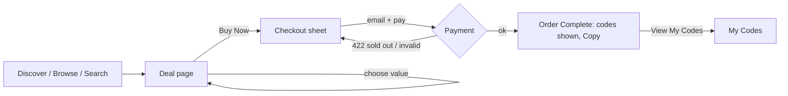

# Eshterakati — UX specification

Status: v1, first pass · Platform: responsive web (phone first) · Design language: Apple Human Interface Guidelines, adapted for the web (see [`design-system/MASTER.md`](../design-system/MASTER.md))

## 1. Product in one line

People buy digital coupon and gift codes (streaming, gaming, food delivery, shopping, travel, software) for less than their face value, get the code instantly, and redeem it with the merchant.

**The core UX risk is trust.** A code is an invisible product bought from a middleman. Every screen has to answer one of: *Is this real? Will it work where I live? What happens if it doesn't?*

## 2. Who it's for

| Person | Job to be done | What they need from us |
| --- | --- | --- |
| **Deal hunter** | "Pay less for the subscriptions I already have." | Clear savings in money and %, a sort by savings, and countdowns that are honest. |
| **Gamer topping up** | "Get store credit right now, mid‑session." | The shortest possible path: deal → Buy Now → code on screen → copy. Guest checkout. |
| **Gift buyer** | "Send someone a gift card." | Several values, buying more than one, and the code by email so they can forward it. |

Usage context: mostly phones, often one‑handed and in a hurry. Desktop is for bigger baskets.

## 3. Principles

1. **Clarity** (HIG) — one primary action per screen. Prices use tabular figures, and savings appear as both money and %.
2. **Deference** (HIG) — the content (merchant, value, price) leads. Chrome is translucent and recedes.
3. **Depth** (HIG) — tasks (Bag, Checkout) open in a sheet over the page, so people never lose their place.
4. **Trust, shown not claimed** — region, validity, verification and the refund promise sit right next to the price, not in a footer.
5. **Codes are secrets** — hidden by default in the wallet, can be copied without being revealed, and are emailed as a backup.
6. **Forgiving** — Undo instead of confirmation dialogs for reversible actions (remove from Bag, Mark as Used).

## 4. Information architecture

```
Discover (/)            Today's pick · categories · trending · ending soon · why buy here
Browse (/browse)        category grid · all deals
  └ Category (/browse/:category?sort=popular|savings|ending)
      └ Deal (/deals/:slug)            options · price · buy · how to redeem · terms · related
Search (/search?q=)     recent · suggested · results
My Codes (/codes?show=active|used)     wallet of purchased codes
Account (/account)      sign in · appearance (theme, RTL) · notifications · support

Sheets (modal, over any page):  Bag → Checkout → Order Complete
```

Every screen and filter can be reached by URL, so back/forward, sharing and refresh all work.

## 5. Navigation model

| Width | Primary navigation | Secondary |
| --- | --- | --- |
| < 768px (phones) | **Tab bar** at the bottom: Discover · Browse · Search · My Codes · Account (5 tabs, icon + label) | Top bar: brand + Bag. On a deal page the tab bar gives way to a sticky **buy bar** (like `hidesBottomBarWhenPushed`). |
| ≥ 768px | **Translucent top bar**: Discover · Browse · My Codes, a search field, Bag, Account | — |

- The current location is shown by colour **and** weight (not colour alone).
- Deeper pages show an iOS‑style back link ("‹ Gaming") at the top of the content.
- After a client‑side navigation, focus moves to the page's `h1` so screen readers announce it.

## 6. Key flows

### Flow 1 — Buy now (the main path)



- **Buy Now** checks out *only that item*. It never sweeps in whatever else is in the Bag.
- Guest checkout: email is the only field. It's pre‑filled from the last order and uses `autocomplete="email"`.
- Validation runs on blur and on submit, never on each keystroke. Errors sit under the field, say what to fix, and focus moves to the field.
- While paying, the button shows a spinner and "Processing…", the sheet can't be dismissed, and inputs are disabled.
- On failure: "The payment didn't go through. **You haven't been charged.** Please try again." Every error tells people whether they were charged.

### Flow 2 — Build a basket

Deal → **Add to Bag** (toast: "Added to Bag · View Bag") → Bag sheet (stepper 1–10, remove with **Undo**) → Check Out → same Checkout as flow 1, with a "‹ Bag" back button.

### Flow 3 — Use a code later

My Codes → find the pass → **Copy** (no need to reveal) → redeem with the merchant → **Mark as Used** (moves to Used, with **Undo**). "How to Redeem" deep‑links to the deal's steps.

### Flow 4 — A code doesn't work *(designed, not built)*

My Codes → **Report a Problem** → sheet: "What happened?" (Rejected as invalid · Already used · Wrong region · Other) + optional screenshot → submitted state with an expected response time → the order status shows "Refund in progress" → refunded. The API marks the code `disputed`; support verifies it with the merchant.

## 7. Screen specs

### Discover
Content priority: today's date eyebrow → large title → **Today's pick** hero (one card, one action) → category chips → Trending (6) → Ending soon (list with live countdowns) → Why buy here (instant delivery, verified, money‑back).

### Deal page
1. Art (merchant tile on a tinted gradient) with "Save up to N%".
2. Merchant · **Verified** · countdown.
3. Title, one‑line description, rating · ratings count · sold.
4. **Value picker** (radio cards). Sold‑out values are disabled and labelled "Sold out".
5. Live price: price, struck‑through face value, "You save $X".
6. Actions: **Buy Now** (filled) and **Add to Bag** (tinted). On phones these sit in a sticky bottom bar.
7. Assurances: instant delivery · *Redeemable in: {region}* · refund guarantee.
8. How to redeem (3 numbered steps) · Terms (disclosure) · Related deals.

### Checkout sheet
Order summary → "Deliver codes to" (email) → "Pay with" (marked **Test mode** until payments are connected) → Summary (face value, **You save** in green, Total) → **Pay $X** → "Secure checkout · Full refund if a code doesn't work".

### Order complete
Animated check → "You're all set" → each code **revealed** (they've just paid for it), with Copy → **View My Codes** (primary) / Done.

### My Codes
Segmented control Active (n) / Used (n). Wallet‑style passes: merchant colour header with face value; code field (masked, eye toggle, Copy); bought date and expiry; actions Mark as Used · How to Redeem · Report a Problem. Empty state links to Discover.

### Search
Search field (44px, clear button). With an empty query it shows Recent (clearable) and Suggested. Results update as you type (debounced) and the URL tracks the query. The no‑results state suggests trying a category and links to Browse.

### Account
Guest card with Sign In. Appearance: Theme (Auto/Light/Dark) and Layout direction (LTR/RTL preview). Notifications: price drops, expiry reminders (switches). Support links.

## 8. States checklist (every data view)

| State | Treatment |
| --- | --- |
| Loading | Skeleton shimmer in the shape of the content (`.skeleton`), reserving space so nothing jumps. Countdowns show "Limited time" until the client clock is known. |
| Empty | Icon + one‑line reason + the next action (Bag, My Codes, Search). |
| Error | `error.tsx`: what happened + **Try Again** (`retry()`). Checkout errors appear inline above Pay. |
| Success | Toast (3s; 5s when it has an action) or the Order Complete screen. |
| Disabled | 45% opacity, `disabled` attribute, not‑allowed cursor. |

## 9. Accessibility

- WCAG AA contrast in **both** themes. The tint is darkened for text (`#0066cc` on light, 5.6:1), and secondary text is `#6e6e73` (5.1:1).
- Touch targets ≥ 44×44px, with ≥ 8px between them. The segmented control is 44px including its track.
- Visible 3px focus rings, a skip link, landmarks, one `h1` per page, sequential headings.
- Prices carry a visually hidden "Face value" label before struck‑through amounts.
- Segmented controls are radio groups with arrow‑key support (reversed in RTL). Switches use `role="switch"`.
- Toasts and live results use `aria-live="polite"` and never steal focus. Form errors use `role="alert"`.
- `prefers-reduced-motion` turns animation off. Sizes are in `rem`, so browser text scaling works.
- Codes use an alphabet without 0/O/1/I so they can be read aloud and retyped.

## 10. Responsive & internationalisation

- Breakpoints: 480 (compact phone tweaks) · 640 (card grid) · 768 (tab bar → top bar, sheet → centred card) · 900 (two‑column deal page).
- No horizontal page scroll at 375px. Only the chip row scrolls sideways, with visible overflow as the affordance.
- **RTL‑ready:** all layout uses logical properties, and directional icons flip. Codes stay LTR (`direction: ltr; unicode-bidi: isolate`). The Account page has an RTL preview toggle.
- The name *Eshterakati* (اشتراكاتي, "my subscriptions") suggests an Arabic‑speaking market. Arabic copy is the main open localisation task (see below).

## 11. Open decisions (need the product owner)

1. **Market & currency** — GCC (SAR/AED) or global USD? Arabic‑first? This drives copy, currency, and payment methods.
2. **Payments** — which provider (e.g. Stripe, Checkout.com, Tap, HyperPay) and which methods (Apple Pay, mada, STC Pay, cards). Payments are stubbed today.
3. **Supply** — are we buying inventory from merchants and distributors (first‑party), or running a marketplace of sellers? A marketplace needs seller verification and changes the meaning of "Verified".
4. **Accounts** — guest‑first (current design) with optional sign‑in, or required accounts? Codes currently live in the browser plus email.
5. **Brand licensing** — real merchant names and logos need permission from each brand. The demo catalogue uses fictional merchants.
6. **Refund policy** — the 30‑day window and evidence required for a "code doesn't work" claim.
